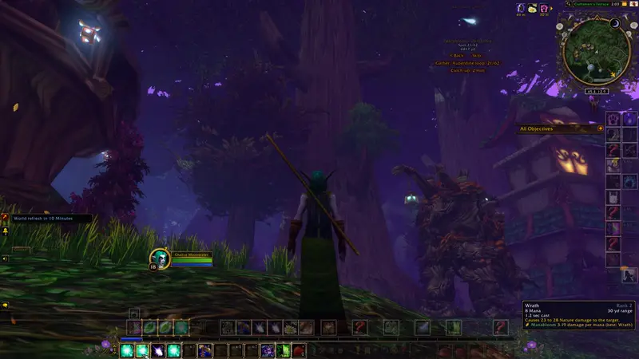

# Manabloom

**A seasonal druid wreath round each action button, coloured by mana efficiency.** The lighter the wreath, the more
damage or healing the spell gives for its mana: your best spell of its kind is palest, your worst darkest. Damage
spells are ranked against damage spells and heals against heals. Made for World of Warcraft: Forever.

Each season has its own wreath and its own colours (below, best spell on the left). Or choose classic colours,
red through violet and blue to moonlight white, all year round.

## In game

A real fight: as you cast, the bramble grows on every wreath, and steps back on a poor cast.

Hovering a spell (or the minimap leaf): leaves drift down the edges of the screen, red round to white.

## What it does

- **The wreath shows the season.** Autumn oak leaves and acorns, winter frost and snowflakes, spring blossom on a
  vine, summer ivy, following the calendar.
- **Colours: classic or seasonal.** Classic runs red to moonlight white all year. Seasonal gives each season its
  own range, worst to best: autumn rust to cream, winter holly berry to snow, spring bare earth to white blossom,
  summer poppy to sunlit cream.
- **Hover a spell** for a line in its tooltip with what it does per point of mana and your best spell of its kind,
  and a few leaves drift down the edges of the screen.
- **A bramble that grows with how well you cast.** While you're casting, a small bramble sits at the top and
  bottom of every wreath, in its own colours: a green bud, a white flower, a black blackberry. Each efficient cast
  (the better half of your spells of that kind) climbs a step: bud, two buds, flower and bud, two flowers, berry and
  flower, two berries. Each poor cast drops a step. A few seconds after you stop, it rests.
- **True to the species.** The flower and berry are bramble, *Rubus fruticosus*, drawn from its flower genes in our
  flower-geometry system: five broad, rounded petals in radial symmetry around an open cup and a ring of many
  stamens; the fruit an aggregate of glossy drupelets on a domed receptacle, with the sepals folded back behind it.
  A real bramble flower has 50 to 100 carpels, each able to become a drupelet; the icon shows 13, set on the golden
  angle, so they still read at the size of an action button.
- **It's alive, quietly:**
  - below a third of your mana your least efficient wreaths wilt and your best glow softly, a nudge towards the
    efficient spells when it matters; drinking brings them back. (Only where the game lets addons read your mana:
    on WoW: Forever it hands it over sealed, so there's no wilting there.)
  - Innervate turns every wreath to spring blossom while it lasts;
  - Moonkin form makes them starlit; cat and bear, where nothing costs mana, curl them shut;
  - the first time you log in in a new season, the old wreaths shed and the new ones grow in;
  - learn a new rank and it says whether it's better per mana, with a small sprout on the old rank's button until
    you put the new one on your bar.

## The minimap button

Hover for your spells ranked by efficiency. **Left-click:** the next season. **Right-click:** classic or seasonal
colours. **Shift-click:** wreaths on or off (the tooltip line and falling leaves stay). Drag to move it round
the minimap.

## Commands

| Command | |
|---|---|
| `/manabloom` | your spells, most efficient first, in their colours |
| `/manabloom colours season` or `classic` | seasonal or classic colours |
| `/manabloom season autumn` (`winter`, `spring`, `summer`, `auto`) | choose the season, or follow the calendar |
| `/manabloom off` or `on` | put the wreaths away, or bring them back (the tooltip line stays) |

## How efficiency is worked out

From each spell's own description and its mana cost: a range like "13 to 16 Nature damage" counts as its average,
and damage or healing over time is added in ("and then an additional 12 over 9 sec"). Durations, ranges and
percentages are left out. Spells with no damage or healing number (Mark of the Wild, Thorns, forms, resurrections)
and spells that cost no mana get no wreath. Talents and gear aren't counted: it reads the base numbers.

## Install

Unzip the `Manabloom` folder into `World of Warcraft\_forever_\Interface\AddOns`, then restart the game. It works on
the default action bars. The TOC also lists the retail interface version, but it was made and tested on Forever.

## Licence

MIT. Not affiliated with or endorsed by Blizzard Entertainment; World of Warcraft names belong to Blizzard.
