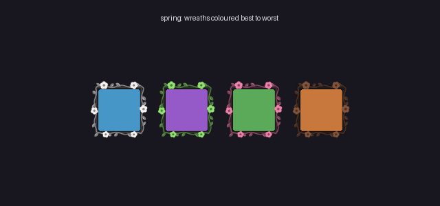
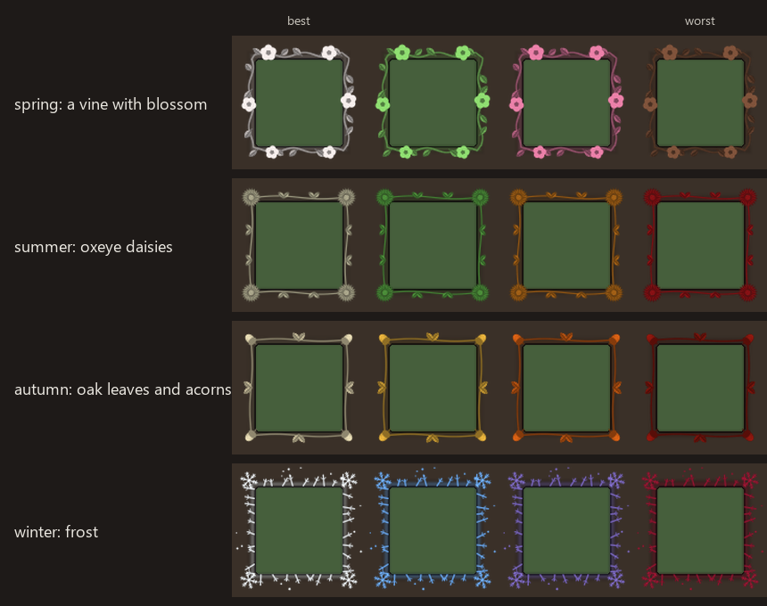
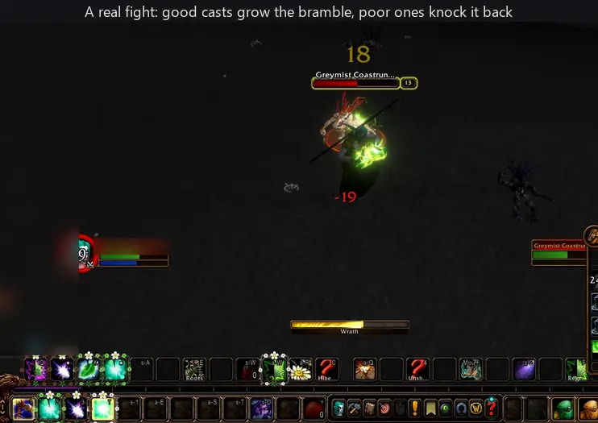
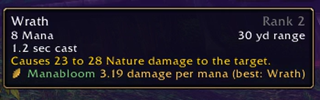
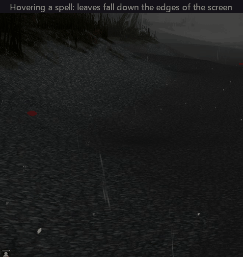
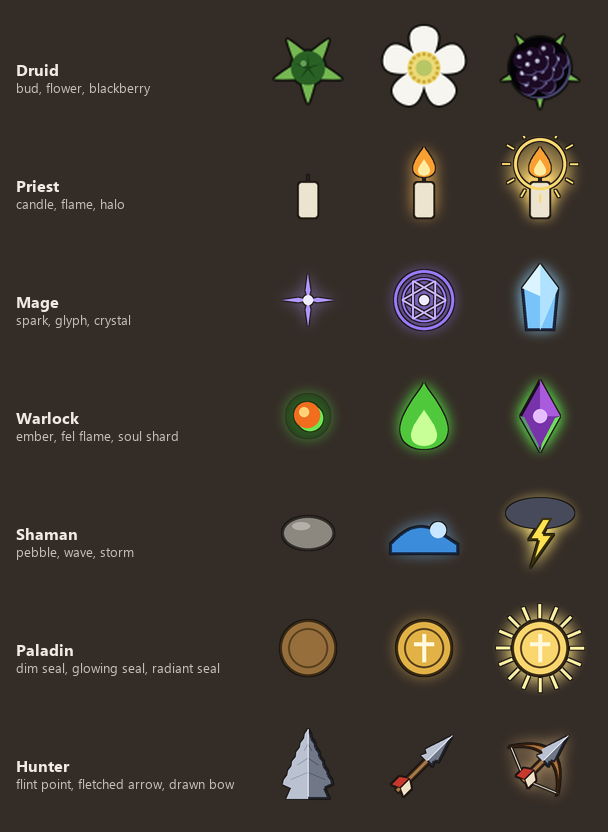

# Manabloom




**A seasonal wreath round each action button, coloured by mana efficiency, for every class that casts with mana.** The lighter the wreath, the more
damage or healing the spell gives for its mana: your best spell of its kind is palest, your worst darkest. Damage
spells are ranked against damage spells and heals against heals. Made for World of Warcraft: Forever.

**What you're looking at:**

- **The wreath is the information.** Every spell that costs mana and does damage or healing gets a thin wreath
  round its action button, coloured by how much it gives for its mana.
- **The bramble grows on the wreath** while you fight: bud, flower, blackberry as you cast well.
- **The falling leaves are decoration.** They drift down the edges of the screen only while you hover a wreathed
  spell, a reminder of the colour scale and nothing more.

Each season has its own wreath and its own colours (below, best spell on the left). Or choose classic colours,
red through violet and blue to moonlight white, all year round. Whichever you choose, the scale runs dark to
light: your worst spell darkest, your best palest, so it reads the same in every season.



## The bramble: bud, flower, blackberry


While you're casting, a bramble grows at the top and bottom of every wreath. Each efficient cast climbs a step,
from a green bud to a white flower to a black blackberry; each poor cast drops one.

## In game

A real fight: as you cast, the bramble grows on every wreath, and steps back on a poor cast.



### The tooltip



Hover a spell and its tooltip gains one line: what it does for each point of mana, and the best spell you have of
the same kind (or "your best damage" when it is the one). The small leaf is tinted in that spell's colour.

### The falling leaves



While your mouse rests on a wreathed spell, or on the minimap leaf, leaves drift down the edges of the screen.
Only those: a spell with no damage or healing number, or one that costs no mana, has no wreath and no leaves.

- **Out of your way.** One leaf a second, left edge then right, inside the outer tenth of the screen, so they never
  cross the middle where you're playing.
- **Slow.** Each takes seven seconds to fall, swaying and turning as it goes.
- **They show the scale.** Their colours walk the wreaths' own scale from darkest to palest over twelve leaves,
  then begin again, so a long hover shows you every colour a spell could be.
- **Gone when you are.** Move the mouse away and no more fall; the ones in the air fade out.
- The only other leaves are a handful flung from each wreath when the season turns or Innervate lands, more from
  your better spells.

Recorded in Darnassus at night.

## What it does

- **The wreath shows the season.** Autumn oak leaves and acorns, winter frost and snowflakes, spring blossom on a
  vine, summer ivy, following the calendar.
- **Colours: classic or seasonal.** Classic runs red to moonlight white all year. Seasonal gives each season its
  own range, worst to best: autumn rust to cream, winter holly berry to snow, spring bare earth to white blossom,
  summer poppy to sunlit cream.
- **Hover a spell** for a line in its tooltip with what it does per point of mana and your best spell of its kind,
  and a few leaves drift down the edges of the screen.
- **A bramble that grows with how well you cast.** While you're casting, a small bramble sits at the top and
  bottom of every wreath, in its own colours: a green bud, a white flower, a black blackberry. Each efficient cast
  (the better half of your spells of that kind) climbs a step: bud, two buds, flower and bud, two flowers, berry and
  flower, two berries. Each poor cast drops a step. A few seconds after you stop, it rests.
- **Each class grows its own.** The druid's is the bramble; every other mana class has a ladder of its own, three
  stages climbed the same way, two at a time:

  

  | Class | Stage 1 | Stage 2 | Stage 3 |
  |---|---|---|---|
  | Druid | bud | flower | blackberry |
  | Priest | unlit candle | lit candle | candle in a halo |
  | Mage | spark | glyph | crystal |
  | Warlock | ember | fel flame | soul shard |
  | Shaman | pebble | wave | storm |
  | Paladin | dim seal | glowing seal | radiant seal |
  | Hunter | flint point | fletched arrow | arrow on a drawn bow |

  Classes without mana (warriors, rogues) get no wreaths; any other mana class gets the bramble.
- **True to the species.** The flower and berry are bramble, *Rubus fruticosus*, drawn from its flower genes in a true-to-life
  flower-geometry system: five broad, rounded petals in radial symmetry around an open cup and a ring of many
  stamens; the fruit an aggregate of glossy drupelets on a domed receptacle, with the sepals folded back behind it.
  A real bramble flower has 50 to 100 carpels, each able to become a drupelet; the icon shows 13, set on the golden
  angle, so they still read at the size of an action button.
- **It's alive, quietly:**
  - below a third of your mana your least efficient wreaths wilt and your best glow softly, a nudge towards the
    efficient spells when it matters; drinking brings them back. (Only where the game lets addons read your mana:
    on WoW: Forever it hands it over sealed, so there's no wilting there.)
  - Innervate turns every wreath to spring blossom while it lasts;
  - for druids, Moonkin form makes them starlit; cat and bear, where nothing costs mana, curl them shut;
  - the first time you log in in a new season, the old wreaths shed and the new ones grow in;
  - learn a new rank and it says whether it's better per mana, with a small sprout on the old rank's button until
    you put the new one on your bar.


## The minimap button

Hover for your spells ranked by efficiency. **Left-click:** the next season. **Right-click:** classic or seasonal
colours. **Shift-click:** wreaths on or off (the tooltip line and falling leaves stay). Drag to move it round
the minimap.

## Commands

| Command | |
|---|---|
| `/manabloom` | your spells, most efficient first, in their colours |
| `/manabloom colours season` or `classic` | seasonal or classic colours |
| `/manabloom season autumn` (`winter`, `spring`, `summer`, `auto`) | choose the season, or follow the calendar |
| `/manabloom off` or `on` | put the wreaths away, or bring them back (the tooltip line stays) |

## How efficiency is worked out

From each spell's own description and its mana cost: a range like "13 to 16 Nature damage" counts as its average,
and damage or healing over time is added in ("and then an additional 12 over 9 sec"). Durations, ranges and
percentages are left out. Spells with no damage or healing number (Mark of the Wild, Thorns, forms, resurrections)
and spells that cost no mana get no wreath. Talents and gear aren't counted: it reads the base numbers.

## Install

Unzip the `Manabloom` folder into `World of Warcraft\_forever_\Interface\AddOns`, then restart the game. It works on
the default action bars. The TOC also lists the retail interface version, but it was made and tested on Forever.

## Licence

MIT. Not affiliated with or endorsed by Blizzard Entertainment; World of Warcraft names belong to Blizzard.

## Talks to

Announces its bramble on the global `ManabloomEvents` (a list of functions called with `("bramble", step, top)`); Stillwater listens.

## Releasing

```sh
git tag -a v1.2.0 -m "1.2.0" && git push origin v1.2.0      # builds the zip, makes the GitHub Release
```

CurseForge uploads are by hand for now, from the zip on the GitHub Release; nothing uploads there automatically.
